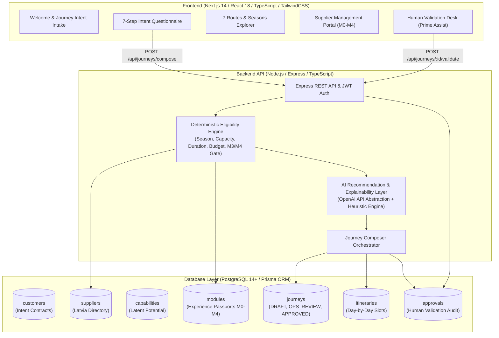

# EXIMIA Journey Composer 🇱🇻

> **Core Architectural Axiom:** *"AI composes. Humans validate."*  
> **Platform Scope:** Latvia Intent-to-Reality Orchestration Platform  
> **Repository:** [https://github.com/maradanijaswanth/Project-Travel](https://github.com/maradanijaswanth/Project-Travel)

---

## 📖 What is EXIMIA Journey Composer?

The **EXIMIA Journey Composer** is a full-stack platform engineered to understand explicit traveler intent and compose personalized, context-valid experiences across **Latvia**.

### The Core Difference:
* It is **NOT** a standard travel booking engine.
* It views territory, cultural heritage, and local suppliers as a **dynamic graph of possibilities** rather than a static catalog of SKUs.
* **Core Principle:** *"AI composes. Humans validate."* The system **never directly auto-confirms bookings**. The AI synthesizes personalized draft journeys, which are subsequently audited and verified by human operators (Prime Assist Inbound Operations) for real-world slot availability, seasonal safety, and net pricing.

---

## 🏛️ System Architecture & Tech Stack



* **Frontend:** Next.js 14 (App Router), React 18, TypeScript, TailwindCSS, Lucide Icons
* **Backend:** Node.js, Express, TypeScript, JWT Authentication, Role-Based Access Control (RBAC)
* **Database & ORM:** Prisma ORM with SQLite for instant local execution, and production-grade PostgreSQL DDL (`database/schema.sql` and `backend/prisma/schema.postgresql.prisma`)
* **AI Layer:** OpenAI API abstraction layer with deterministic heuristic rule fallback for guaranteed high-availability offline/online operation.
* **Human Validation Engine:** Complete workflow state machine: `DRAFT` &rarr; `OPS_REVIEW` &rarr; `APPROVED` &rarr; `CONFIRMED` / `REJECTED`.

---

## 🗺️ The Knowledge Layer: Seven Meaning Routes & Four Seasons

The platform structures Latvia into seven thematic meaning corridors and the central Rīga Gateway:

1. **Līvu Road (Līvu ceļš):** Sea, fishing, coast, maritime culture, Kolka horn, Livonian heritage.
2. **Daugava Road (Daugavas ceļš):** River of Destiny, medieval strongholds, ancient trade routes, Likteņdārzs.
3. **Baltic Way (Baltijas ceļš):** Freedom, cooperation, 1989 human chain, shared Baltic history.
4. **Jacob Road (Jēkaba ceļš):** Duke Jacob of Courland, entrepreneurship, craft guilds, Kuldīga, Ventspils.
5. **Freedom Road (Brīvības ceļš):** Leadership, statehood, civic identity, Cēsis battles, Freedom Monument.
6. **Light Road (Gaismas ceļš):** Knowledge, learning, Dainas folk songs, Castle of Light, enlightenment trails.
7. **Māra Road (Māras ceļš):** Traditions, regional food, black clay pottery, sacred nature groves, hospitality.
8. **Rīga Gateway (R0–R3 Hub):** UNESCO Old Town, Art Nouveau Quiet Center, Central Market pavilions.

### Four Seasons & Seasonal Lenses:
* **Spring:** *Awakening* (birch sap tapping, flooding meadows, migrating birds in Ķemeri)
* **Summer:** *Expansion* (white nights, Jāņi midsummer solstice fires, golden Baltic dunes)
* **Autumn:** *Integration* (amber foliage in Gauja valley, wild mushroom & lingonberry foraging)
* **Winter:** *Silence* (snowshoe bog boardwalks, wood-fired black saunas, candlelit medieval cellar banquets)

---

## 🏭 Supplier Capability Network & Maturity Model (M0 to M4)

The database includes demo Latvia suppliers:
* **Hotels:** Grand Palace Hotel Riga, Grand Poet Hotel, Radisson Blu Latvija
* **Restaurants:** 3 Pavāru (3 Chefs Restaurant), Rozengrāls
* **Activities:** Riga Old Town Walking Tour, Sigulda Nature Tour, Gauja National Park, Daugava River Cruise, Pottery Workshop, Latvian Cooking Class, Baltic Way History Experience
* **Transport:** Chauffeur Service (Mercedes-Benz V-Class), VIP Airport Transfer

### Maturity Pipeline:
* `M0`: Discovered
* `M1`: Basic supplier verified
* `M2`: Structured conditional preview (Internal co-design)
* `M3`: Commercially validated (**Customer Ready**)
* `M4`: Delivered & measured with quality metrics
> ⚠️ **Strict Architectural Rule:** Only **M3** and **M4** modules are exposed to customers during AI composition.

---

## 💻 How to Use in VS Code (Step-by-Step Guide)

Follow this exact guide to clone, open, configure, and run the project inside Visual Studio Code.

### Step 1: Open VS Code and Clone the Repository
Open your terminal (or VS Code built-in terminal: ``Ctrl + ` ``) and clone the repository:

```bash
git clone https://github.com/maradanijaswanth/Project-Travel.git
cd Project-Travel
```

Then open the project directory in VS Code:
```bash
code .
```

---

### Step 2: Set Up and Run the Backend API (Terminal 1)

In VS Code, open a new terminal (``Ctrl + Shift + ` ``):

1. **Navigate to the backend directory:**
   ```bash
   cd backend
   ```

2. **Create the environment file:**
   * On Windows (PowerShell):
     ```powershell
     Copy-Item .env.example .env
     ```
   * On Linux / macOS / Bash:
     ```bash
     cp .env.example .env
     ```

3. **Install backend dependencies:**
   ```bash
   npm install
   ```

4. **Initialize the Database and Run Migrations:**
   ```bash
   npx prisma db push
   ```
   *(This creates the database `dev.db` and generates the Prisma Client)*

5. **Seed the Latvia Database:**
   ```bash
   npx tsx prisma/seed.ts
   ```
   *Output confirmation:*
   ```text
   🌱 Starting EXIMIA Journey Composer Latvia Seed Data...
   ✅ Created users: admin@eximia.lv, operator@primeassist.lv (Password: Eximia2026!)
   ✅ Created 14 Latvia Suppliers
   ✅ Created 15 Experience Modules (including M3/M4 customer-ready and M1/M2 co-design candidates)
   ✅ Created Demo Customer & Journey in OPS_REVIEW status
   🎉 Seed completed successfully!
   ```

6. **Start the Backend Server:**
   ```bash
   npm run dev
   ```
   *The backend will start on **`http://localhost:5000`**.*  
   *Verify in your browser:* [http://localhost:5000/api/health](http://localhost:5000/api/health)

---

### Step 3: Set Up and Run the Frontend UI (Terminal 2)

Split the terminal in VS Code or click the **`+`** icon to open a second terminal:

1. **Navigate to the frontend directory:**
   ```bash
   cd frontend
   ```

2. **Install frontend dependencies:**
   ```bash
   npm install
   ```

3. **Start the Next.js development server:**
   ```bash
   npm run dev
   ```
   *The frontend will start on **`http://localhost:3000`**.*

---

### Step 4: Open and Explore the Application

Open your browser and navigate to:
👉 **[http://localhost:3000](http://localhost:3000)**

1. **Compose a Journey (`/`):**
   - Click **"Begin Intent Questionnaire"**
   - Step through the 7 intent questions:
     1. Purpose (e.g. Cultural Discovery, Family Vacation)
     2. Party (Alone, Couple, Family, Friends, Business Delegation)
     3. Stay duration (1 to 14 days)
     4. Season (Spring, Summer, Autumn, Winter)
     5. Interests (Culture, Nature, Food, etc.)
     6. Budget Tier (Budget, Standard, Premium, Luxury)
     7. Special needs (accessibility, kids, dietary notes) + contact details
   - Click **"Compose My Latvia Journey"**
   - Inspect the generated **AI Rationale**, Suggested Hotel, Dining, Activities, Transport, and Day-by-Day schedule.
   - Click **"Submit for Human Operator Validation"** to transition from `DRAFT` to `OPS_REVIEW`.

2. **7 Routes Explorer (`/routes`):**
   - Browse the Seven Meaning Routes of Latvia and Four Seasonal Lenses with active module distribution metrics.

3. **Supplier Management Portal (`/suppliers`):**
   - View all 14 Latvia suppliers.
   - Filter by Category, Season, Location, or Maturity Level (M0 to M4).
   - Inspect capabilities, add new experience module passports, and promote maturity.

4. **Prime Assist Human Validation Desk (`/admin`):**
   - Click **Operator Sign In** (or navigate to `/login`).
   - Use the **1-Click Demo Login** for Operator (`operator@primeassist.lv`) or Admin (`admin@eximia.lv`).
   - View pending customer requests and draft journeys.
   - Open the **Audit & Validate** modal: check off Supplier Slot verification, Pricing verification, Safety verification, enter operator comments, and click **Approve** or **Confirm**!

---

## 🔑 Demo Account Credentials

| Role | Email | Password | Access Rights |
| :--- | :--- | :--- | :--- |
| **Prime Assist Operator** | `operator@primeassist.lv` | `Eximia2026!` | Human validation queue, slot audit & sign-off |
| **System Administrator** | `admin@eximia.lv` | `Eximia2026!` | Full supplier CRUD, M0–M4 maturity controls, analytics |
| **Customer / Guest** | *Public / Self-service* | *None required* | Free questionnaire & draft journey creation |

---

## 🗄️ Database Documentation & Files

* **Production PostgreSQL DDL:** [`database/schema.sql`](./database/schema.sql)
* **Sample SQL & Eligibility Queries:** [`database/sample_queries.sql`](./database/sample_queries.sql)
* **Full ER Diagram & Normalization Plan:** [`database/er_diagram.md`](./database/er_diagram.md)
* **Prisma PostgreSQL Definition:** [`backend/prisma/schema.postgresql.prisma`](./backend/prisma/schema.postgresql.prisma)

---

## 📄 License
ISC License &copy; 2026 EXIMIA & Prime Assist.
